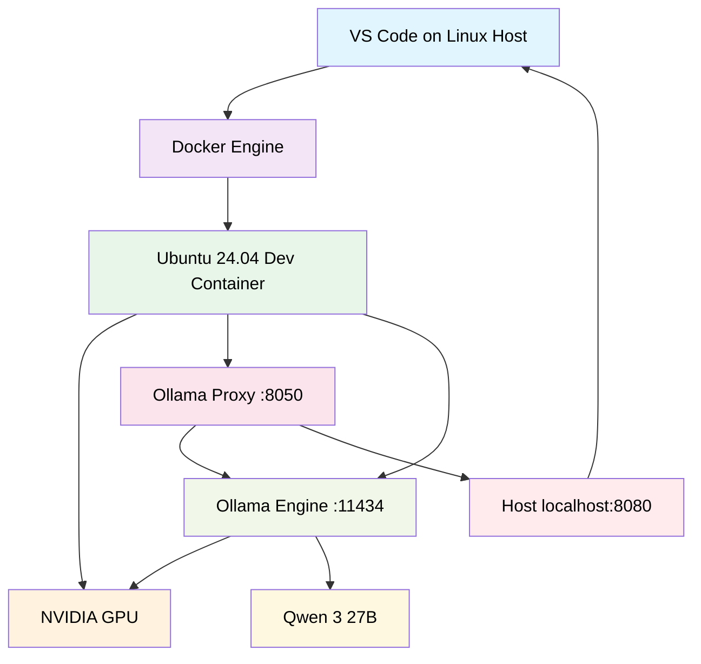

# Local LLM Setup Guide: Linux-Only Hardened Development Environment with Qwen 3

[](https://github.com/Bureau-Of-Control/ContainmentProcedures/actions/workflows/test.yml)

**Software:** VS Code, Docker Engine, Ollama\
**Host OS:** Ubuntu 24.04 LTS\
**LLM:** Qwen 3 27B\
**GPU:** NVIDIA RTX 3090 / RTX 4090 (24 GB VRAM)\
**Container:** Ubuntu 24.04 with NVIDIA CUDA runtime

---

## Overview

This guide describes how to reproduce the original local LLM development environment described in original article on a native Linux host, without Windows, WSL2, or Docker Desktop. Native Linux setup has a huge advantage over Windows setup - due to ability to use mmap for direct data exchange between SSD and VRAM, on Linux Ollama loads full Qwen 3 27B (size around 16GB) into GPU in just 6 seconds if model files are located on fast modern SSD, while on Windows same process takes up to 8-10 minutes.

This guide is minimal, make sure to read the original one for more details on model parameters tune-up, VS Code settings, etc.

The architecture and software remain unchanged:

- Visual Studio Code with Dev Containers.
- Docker Engine running natively on Linux.
- NVIDIA GPU acceleration through NVIDIA Container Toolkit.
- Ollama running inside an isolated development container.
- Qwen 3 27B with an 82K context target and Q8 KV cache.
- A Python proxy providing OpenAI-compatible API access and reasoning presets.

The main difference is that Linux handles NVIDIA GPU access directly through Docker.

The LLM engine and proxy remain inside the container. Only the proxy is exposed to the host.

## Architecture



The host filesystem is not mounted wholesale into the container. Only the project workspace is accessible.

## System Requirements for LLM host

| Component | Requirement |
| --- | --- |
| RAM | 16 GB minimum |
| GPU | NVIDIA RTX 3090 or RTX 4090 |
| VRAM | 24 GB |
| Storage | 35-40 GB minimum free space |
| CPU | Modern x86-64 processor |
| OS | Ubuntu 24.04 LTS |
| GPU driver | NVIDIA driver compatible with Ollama |

**Important:** 35-40 GB is a tight storage budget for a 27B model, CUDA image layers, and Docker build cache. More free space is strongly recommended.
The original guide targets approximately 82,000 tokens of context with Q8 KV cache precision and one parallel request. 
This is a demanding configuration. Actual performance depends on model quantization, available VRAM, GPU utilization, and context allocation.

Do not assume 82K will fit on every 24 GB GPU configuration. Verify actual GPU allocation with `ollama ps`.

## Setup Process

### Phase 1: Prepare the Linux Host

1. **Install NVIDIA drivers**

Install the recommended proprietary NVIDIA driver for your distribution. Note that Cuda 13.3 used in this guide is supported since versions 580x.

On Ubuntu:

```bash
sudo apt update
sudo ubuntu-drivers devices
sudo ubuntu-drivers install
sudo reboot
```

After reboot, verify the driver:

```bash
nvidia-smi
```

You should see your NVIDIA GPU, driver version, and available VRAM. Do not install NVIDIA's CUDA driver inside the Docker container. The host driver is responsible for GPU access.

2. **Install Docker Engine**

Follow the official Docker Engine installation instructions:

https://docs.docker.com/engine/install/ubuntu/

Install Docker Engine and the Compose plugin.

Verify:

```bash
sudo systemctl enable --now docker

docker version
docker compose version
```

For convenience, you can add your user to the Docker group:

```bash
sudo usermod -aG docker $USER
```

Log out and log back in.

**Security note:** Membership in the Docker group effectively grants root-level control over the host. Do not add untrusted users to this group.

3. **Install NVIDIA Container Toolkit**

Follow the official NVIDIA installation instructions:

https://docs.nvidia.com/datacenter/cloud-native/container-toolkit/latest/install-guide.html

For Ubuntu/Debian, the following is the general installation procedure:

```bash
curl -fsSL https://nvidia.github.io/libnvidia-container/gpgkey \
  | sudo gpg --dearmor \
  -o /usr/share/keyrings/nvidia-container-toolkit-keyring.gpg

curl -fsSL https://nvidia.github.io/libnvidia-container/stable/deb/nvidia-container-toolkit.list \
  | sed 's#deb https://#deb [signed-by=/usr/share/keyrings/nvidia-container-toolkit-keyring.gpg] https://#g' \
  | sudo tee /etc/apt/sources.list.d/nvidia-container-toolkit.list

sudo apt update

sudo apt install -y nvidia-container-toolkit
```

Configure Docker:

```bash
sudo nvidia-ctk runtime configure --runtime=docker

sudo systemctl restart docker
```

Test GPU access from a container:

```bash
docker run --rm --gpus all ubuntu:24.04 nvidia-smi
```

If this command works, Docker GPU passthrough is configured correctly.

4. **Install Visual Studio Code**

Install VS Code using Microsoft's official Linux instructions:

https://code.visualstudio.com/docs/setup/linux

Install the following extensions:

- Dev Containers (`ms-vscode-remote.remote-containers`)
- Docker (`ms-azuretools.vscode-docker`)

GitHub Copilot and Cline are optional and will be configured later.

## Phase 2: Create the project structure and Dev Container Configuration

Create a dedicated project directory:

```bash
mkdir -p ~/Code/LocalLLM
cd ~/Code/LocalLLM

mkdir -p .devcontainer
mkdir -p models
mkdir -p custom
```

The resulting structure:

```text
LocalLLM/
├── .devcontainer/
│   ├── devcontainer.json
│   └── Dockerfile
├── custom/
│   └── Modelfile
├── models/
├── ollama_proxy.py
└── start_llm.sh
```

The `models` directory will persist between container rebuilds.

Ensure that the host user owns the directory:

```bash
sudo chown -R "$(id -u):$(id -g)" models
```

## Phase 3: Configure the development container

1. **Define the Environment (Dockerfile)**

Create `.devcontainer/Dockerfile`:

```dockerfile
FROM nvidia/cuda:13.3.0-runtime-ubuntu24.04

ENV DEBIAN_FRONTEND=noninteractive

RUN apt-get update && apt-get install -y --no-install-recommends \
    curl \
    git \
    build-essential \
    ca-certificates \
    gnupg2 \
    zstd \
    sudo \
    python3 \
    python3-pip \
    && rm -rf /var/lib/apt/lists/*

# Install Ollama
RUN curl -fsSL https://ollama.com/install.sh | sh

# Create an unprivileged development user.
ARG USERNAME=coder
ARG USER_UID=1000
ARG USER_GID=1000

RUN if getent passwd ${USER_UID} >/dev/null; then \
        # If UID 1000 exists, find its current name and rename it to your username
        EXISTING_USER=$(getent passwd ${USER_UID} | cut -d: -f1); \
        if [ "${EXISTING_USER}" != "${USERNAME}" ]; then \
            usermod -l ${USERNAME} ${EXISTING_USER} && \
            groupmod -n ${USERNAME} $(getent group ${USER_GID} | cut -d: -f1) && \
            usermod -d /home/${USERNAME} -m ${USERNAME}; \
        fi; \
    else \
        # If UID 1000 is free, create the group and user from scratch
        if ! getent group ${USER_GID} >/dev/null; then \
            groupadd --gid ${USER_GID} ${USERNAME}; \
        fi; \
        useradd --uid ${USER_UID} --gid ${USER_GID} --create-home --shell /bin/bash ${USERNAME}; \
    fi \
    && echo "${USERNAME} ALL=(ALL) NOPASSWD:ALL" > /etc/sudoers.d/${USERNAME} \
    && chmod 0440 /etc/sudoers.d/${USERNAME}

ENV OLLAMA_MODELS=/workspaces/Code/models
ENV OLLAMA_CONTEXT_LENGTH=82000
ENV OLLAMA_KV_CACHE_TYPE=q8_0
ENV OLLAMA_HOST=0.0.0.0
ENV OLLAMA_KEEP_ALIVE=24h

RUN mkdir -p /workspaces/Code/models \
    && chown -R ${USERNAME}:${USERNAME} /workspaces/Code

EXPOSE 11434
EXPOSE 8050

USER ${USERNAME}

WORKDIR /workspaces/Code
```

The CUDA image provides the runtime libraries required by GPU workloads. The actual NVIDIA driver is supplied by the host through NVIDIA Container Toolkit.

The example uses UID/GID 1000. If your Linux account uses different IDs, change the build arguments accordingly.

2. **Route the GPU and Sandbox Settings (devcontainer.json)**

Create `.devcontainer/devcontainer.json`:

```json
{
  "name": "Secure Local LLM Coding Sandbox",

  "build": {
    "dockerfile": "Dockerfile",
    "args": {
      "USERNAME": "coder",
      "USER_UID": "1000",
      "USER_GID": "1000"
    }
  },

  "runArgs": [
    "--gpus=all",
    "--ipc=host",
    "-p",
    "0.0.0.0:8080:8050"
  ],

  "workspaceMount": "source=${localWorkspaceFolder},target=/workspaces/Code,type=bind",
  "workspaceFolder": "/workspaces/Code",

  "containerEnv": {
    "OLLAMA_HOST": "0.0.0.0",
    "OLLAMA_FLASH_ATTENTION": "1",
    "OLLAMA_KV_CACHE_TYPE": "q8_0",
    "OLLAMA_NUM_PARALLEL": "1",
    "OLLAMA_MODELS": "/workspaces/Code/models",
    "OLLAMA_CONTEXT_LENGTH": "82000",
    "OLLAMA_KEEP_ALIVE": "24h",
    "OLLAMA_MAX_LOADED_MODELS": "1",
    "NVIDIA_VISIBLE_DEVICES": "all",
    "NVIDIA_DRIVER_CAPABILITIES": "compute,utility"
  },

  "customizations": {
    "vscode": {
      "extensions": [
        "ms-azuretools.vscode-docker",
        "GitHub.copilot",
        "GitHub.copilot-chat"
      ],
      "settings": {
        "github.copilot.editor.enableAutoCompletions": true
      }
    }
  },

  "remoteUser": "coder"
}
```

Important differences from the Windows configuration:

- `--gpus=all` replaces WSL-specific GPU configuration.
- `/usr/lib/wsl/drivers` is no longer mounted.
- `LD_LIBRARY_PATH` no longer needs WSL-specific driver paths.
- The workspace is explicitly mounted into the container.

The Ollama native API remains on port 11434 inside the container. The proxy listens on port 8050 from inside of the container (use this port to configure VS Code BYOK model), and on port 8080 on the outside (for other tools on host machie for which you might want to have access + for proxy monitoring endpoint).

## Phase 4: Build and initialize the container

Open the project:

```bash
code ~/Code/LocalLLM
```

In VS Code:

1. Open the Command Palette (`Ctrl+Shift+P`).
2. Select `Dev Containers: Reopen in Container`.
3. Wait for the initial Docker build.
4. Open a terminal inside the container.

Verify the GPU:

```bash
nvidia-smi
```

If the command fails, check the NVIDIA Container Toolkit installation before proceeding.

## Phase 5: Download the models

Start Ollama in the first VS Code terminal:

```bash
ollama serve
```

Leave it running.
In a second terminal:

```bash
ollama pull nomic-embed-text
ollama pull qwen3.8:27b
```

**Base model:** `qwen3.8:27b` is the base model used throughout this guide — it is also the `FROM` target in `custom/Modelfile`. Pull exactly this tag so your local `qwen3-coder` wrapper resolves to the same weights you tuned against.

After downloading:

```bash
ollama list
```

The model files should be stored under:

```text
/workspaces/Code/models
```

Because this is a persistent host-mounted directory, rebuilding the development container will not require downloading the models again.

## Phase 6: Create a custom Modelfile

Create:

```text
custom/Modelfile
```

Use the original model identifier after verifying it:

```dockerfile
# Inherit from your installed Qwen 3 model
FROM qwen3.8:27b

# Adjust decoding parameters to break loops
PARAMETER temperature 0.5
PARAMETER top_p 0.90
PARAMETER top_k 20
PARAMETER repeat_penalty 1.08
PARAMETER repeat_last_n 256
PARAMETER frequency_penalty 0.20
PARAMETER presence_penalty 0.0
PARAMETER num_predict -1

# Define explicit behavioral guardrails
SYSTEM """
You are an expert software engineer specializing in deep system debugging and impact analysis. When analyzing a coding problem or a test failure, state your conclusion once. Do not re-evaluate the same assumptions or repeat your logical deductions. Move directly and quickly from your initial analysis to the final, comprehensive code implementation.

[CRITICAL REASONING PROTOCOL]
When analyzing logs against code, you MUST follow this strict step-by-step reasoning protocol:
1. HYPOTHESIS LISTING: List up to 3 distinct potential causes indicated by the logs.
2. ELIMINATION & TRACKING: Dedicate a thought line to ruling out causes. Explicitly label rejected ideas with "REJECTED [Reason]". Never re-evaluate a hypothesis once it is labeled REJECTED.
3. STRATEGY SELECTION: Choose the most viable remaining strategy. State the strategy clearly in one sentence.
4. SINGLE-PASS IMPACT ANALYSIS: Evaluate the implications of the chosen approach exactly ONCE by checking for breaking changes across boundaries. Do not run this evaluation in a circle; accept the trade-offs or pivot immediately if a fatal flaw is found.
5. IF STUCK: If you find yourself analyzing the same failure symptom or variable state for a third time, explicitly state "Loop detected: Switching paradigm" and shift focus to environmental, data-type, or concurrency root causes instead of logic flow.
"""
```

Create the wrapper:

```bash
ollama create qwen3-coder -f custom/Modelfile
```

Verify:

```bash
ollama list
```

The model wrapper is named `qwen3-coder`. Write down this ID — you'll reference it in every later phase (proxy config, BYOM entries, Cline setup). The `ollama create` step is fast; it only registers a thin wrapper around the already-downloaded base model. When done with this one-time tuning step, stop the standalone `ollama serve` you started earlier (`Ctrl+C`) — the launcher script in Phase 8 will manage its own instance.

### Why Qwen needs a Modelfile at all

Qwen 3 is a very capable coding model, but on stock settings it is **prone to overthinking**. While doing so it frequently falls into endless reasoning loops — "Wait, let me reconsider…" about the same sequence of things over and over again. That behavior garbles up the context window and typically requires human intervention to break out of. The Modelfile above exists specifically to suppress that loop-proneness while preserving code quality. With this wrapper in place, even on the `high` thinking preset, loop incidents drop from roughly 10–12 per day (stock settings) to near zero for most workloads.

### What each PARAMETER does

- **`temperature 0.5`** — controls output randomness. Higher values are more creative but chaotic; lower values are more predictable and focused. This value injects just enough entropy into token selection to help the model "jump the track" when its logic starts looping, while staying highly focused on technical accuracy rather than rigid determinism.
- **`top_p 0.90`** — nucleus sampling: filters out the least likely words. Industry default is 0.95 (keep top 95% of probability mass). Our slightly tighter 0.90 cuts off the bottom 10% of low-probability tokens. When you raise temperature as we did here, you risk introducing garbage tokens; tightening `top_p` acts as a guardrail keeping the expanded creativity strictly professional and relevant.
- **`top_k 20`** — limits next-token selection to the top-k most probable tokens. Qwen's thinking logic is fine-tuned around a tight `top_k ≈ 20`, which focuses its initial token space without over-constraining it.
- **`repeat_penalty 1.08`** — penalizes immediate sequential repetition of exact phrases in the output stream. A value of 1.0 means no penalty; our gentle nudge is high enough to stop infinite text loops but low enough that it won't break formatting where word repetition is legitimate (code syntax, lists, standard grammar like "the"/"and"). If you need to tune this up, never push above ~1.12–1.15 or the model will start treating normal code syntax as penalized repetition and degrade badly on coding tasks.
- **`repeat_last_n 256`** — how far back (in tokens) the model looks when applying `repeat_penalty`. Works especially well against n-gram repetition loops inside the internal thinking state, where the same big phrase gets repeated over and over across many tokens.
- **`frequency_penalty 0.20`** — unlike `repeat_penalty` (which punishes *immediate* sequential repetition), this punishes a token based on how often it has appeared anywhere in the entire history. This directly targets reasoning loops because it penalizes returning to favorite loop-phrases ("Wait", "reconsider", "correct", "look") over the span of a long thought process.
- **`presence_penalty 0.0`** — disables any bonus/penalty for whether a token has already appeared at all. The model chooses purely by its trained probabilities; we don't want an extra bias layered on top of the other two penalties.
- **`num_predict -1`** — no hard cap on output length per response. Capping this is dangerous for thinking models: hitting the limit mid-reasoning truncates the chain-of-thought, which can cause "Sorry, no response was returned" errors or worse, silently break the model's current line of reasoning. Leaving it unlimited lets long explanations and complex code blocks finish naturally.

The `SYSTEM` prompt is the cherry on top: it gives Qwen an explicit step-by-step protocol (hypothesis listing → elimination with REJECTED labels → single-pass impact analysis → forced paradigm switch if stuck) that structurally prevents re-evaluating the same assumption twice.

### ⚠️ Important caveats about these parameters

- **Optimized for THINKING mode.** These values are tuned specifically for reasoning-enabled coding workloads. They will likely be suboptimal for non-thinking mode, where different parameter balances apply. If you disable thinking entirely, expect to retune.
- **Reasoning level matters.** For Qwen 3 in particular, experience suggests the `medium` thinking preset works best overall. On `high` or higher, Qwen tends to overthink heavily — it tries to think through the whole architecture end-to-end before writing a single line of code. That huge chain of thought overflows small context windows and is very slow; a single planning pass without any code edits can drag on for tens of minutes. Use `high` deliberately for genuinely hard analysis tasks, not as a default.
- **Starting points, not universal optima.** The values above were verified against real coding workloads but your model quantization, GPU, and task mix may shift the sweet spot slightly. Treat them as a strong baseline and adjust from there if needed.

## Phase 7: Configure the Ollama proxy

Copy the proxy from the original repository:

```bash
curl -fL \
  https://raw.githubusercontent.com/Bureau-Of-Control/ContainmentProcedures/main/utility/ollama_proxy.py \
  -o ollama_proxy.py
```

### What the proxy actually does

The proxy (`ollama_proxy.py`) is a small stdlib-only Python script that sits between your VS Code BYOM / Cline client and Ollama. It does three important things:

1. **Forces all requests to one fixed model.** Whatever `model` ID the client sends, it gets rewritten to your wrapper (`qwen3-coder`). This is what makes the thinking presets below possible — you can register several BYOM entries with different IDs and they all hit the same underlying local model.
2. **Decodes thinking directives from the BYOM model ID.** A `-nothink` suffix maps to `reasoning_effort=none`, and `-think-low|medium|high|max` map to the matching effort level, injected into the OpenAI-compat request (Ollama's `/v1/chat/completions` ignores a top-level `think` field but honors `reasoning_effort`). Any ID without a recognized suffix falls through to `--default-effort` (or Ollama's default behavior).
3. **Optionally strips Windows-native tools** (`--filter-windows-tools`) from chat-completion payloads, so a Linux-sandboxed model never sees PowerShell/cmd tool definitions.

It also duplicates all logs (including crash tracebacks) to a file via `--log-file`. Useful flags: `--default-effort <level>` sets a baseline effort for requests without a directive suffix, and `--ollama-url` overrides the upstream address (defaults to `http://127.0.0.1:11434`, which is exactly what we want here — Ollama stays on its internal port inside the container; only the proxy is exposed externally).

For Linux-only clients, Windows tool filtering is not strictly necessary, but retaining the original proxy option preserves compatibility with existing client configurations and costs nothing.

Full proxy documentation lives in [`ollama_proxy.md`](utility/ollama_proxy.md) in this repository.

## Phase 8: Create the launcher

Create `start_llm.sh`:

```bash
#!/usr/bin/env bash
# start_llm.sh — launch Ollama + ollama_proxy.py together.
# Ctrl-C stops both. Logs: /tmp/ollama.log, /tmp/ollama_proxy.log

set -euo pipefail

cd "$(dirname "$0")"

export OLLAMA_CONTEXT_LENGTH=78000
export OLLAMA_KV_CACHE_TYPE=q8_0
export OLLAMA_NUM_PARALLEL=1
export OLLAMA_KEEP_ALIVE=24h
export OLLAMA_MAX_QUEUE=512

# Reasoning coalescing defaults are now built into ollama_proxy.py (INTERVAL=5, CHARS=1000).
# Override here only if you want different values than the proxy defaults:
# export PROXY_REASONING_FLUSH_INTERVAL=30   # fewer, larger cards; no loop monitoring needed
# export PROXY_REASONING_FLUSH_CHARS=999999 # effectively disable size-flush

# Start Ollama.
ollama serve > /tmp/ollama.log 2>&1 &

OLLAMA_PID=$!
PROXY_PID=""

cleanup() {
    if [ -n "$PROXY_PID" ]; then
        kill "$PROXY_PID" 2>/dev/null || true
    fi

    kill "$OLLAMA_PID" 2>/dev/null || true
}

trap cleanup EXIT INT TERM

# Wait for Ollama to become available.
READY=0

for i in $(seq 1 60); do
    if curl -sf http://127.0.0.1:11434/api/version \
        > /dev/null; then
        READY=1
        break
    fi

    sleep 1
done

if [ "$READY" -ne 1 ]; then
    echo "Ollama failed to start. Check /tmp/ollama.log"
    exit 1
fi

# Pre-warm the model.
ollama run qwen3-coder ""

# Optional shared-secret auth. Leave PROXY_PASSWORD empty for an unauthenticated local-only setup (the default). Set it if you expose port 8080 on a LAN/tunnel — then VS Code BYOM must use this value as its API key, and the web UI (/_log, /_status) asks for username PROXY_AUTH_USER + this password via HTTP Basic auth. See utility/ollama_proxy.md → "Optional authentication".
PROXY_PASSWORD=""          # e.g. 's3cr3t-pw' to enable auth; empty = disabled
PROXY_AUTH_USER="proxy"    # Basic-auth username shown in the browser pop-up

AUTH_ARGS=()
if [ -n "$PROXY_PASSWORD" ]; then
    AUTH_ARGS=(--password "$PROXY_PASSWORD" --auth-user "$PROXY_AUTH_USER")
fi

# Start the proxy. The proxy tees its own stdout/stderr into --log-file (so /_log web UI works). We redirect shell-level stdout/stderr to /dev/null so nothing spills to the terminal; all logging goes through the internal tee to the real file.
python3 -u ollama_proxy.py \
    --model qwen3-coder \
    --port 8050 \
    --filter-windows-tools \
    "${AUTH_ARGS[@]}" \
    --log-file /tmp/ollama_proxy.log \
    > /dev/null 2>&1 &

PROXY_PID=$!

echo "Ollama and proxy are running."
echo "Proxy: http://127.0.0.1:8050"
[ -n "$PROXY_PASSWORD" ] && echo "Auth: ENABLED — use '$PROXY_AUTH_USER' + your PROXY_PASSWORD as the BYOM API key / Basic-auth password." || echo "Auth: disabled (no PROXY_PASSWORD set)."
echo "Press Ctrl-C to stop."

wait "$OLLAMA_PID"
```

Make it executable:

```bash
chmod +x start_llm.sh
```

Start the complete environment:

```bash
./start_llm.sh
```

The script starts Ollama, waits for its API, pre-warms the model, and starts the proxy. If you set `PROXY_PASSWORD`, remember to put that same value into VS Code's BYOM **API key** field (and use it as the Basic-auth password on the web UI) — see Phase 10 below.

Logs:

```text
/tmp/ollama.log        # raw Ollama engine output (model loading, generation warnings)
/tmp/ollama_proxy.log  # per-request proxy logs + crash tracebacks; also served live at http://localhost:8080/_log
```

Stop the stack with `Ctrl+C` — this cleanly shuts down both processes and frees any in-flight Ollama slot.

### All set! Quick sanity check

Your LLM engine should now be running inside the container at `http://localhost:11434`, with the proxy in front of it at `http://localhost:8050`, exposed to the host on port **8080**. From another machine on your LAN you can verify reachability via `http://<host_system_ip>:8080/` (the proxy passes GET requests straight through to Ollama). Proxy health is available at `http://<host_system_ip>:8080/_health`, and a live log viewer at `http://<host_system_ip>:8080/_log`.

**Note:** since Ollama is no longer directly reachable from outside the container, anything else you had pointing at `:8080` expecting raw Ollama (e.g., an `ollama` CLI on another machine) will now hit the proxy — which only forwards POST/GET chat paths. That's fine for BYOM clients but worth knowing. If you do need raw Ollama externally, see [Optional: Expose the native Ollama API](#optional-expose-the-native-ollama-api) below.

## Phase 9: Verify GPU utilization

Open another terminal inside VS Code.

Check the GPU:

```bash
nvidia-smi
```

Check Ollama:

```bash
ollama ps
```

Expected behavior:

- The Qwen model should appear in `ollama ps`.
- GPU memory usage should increase.
- The model should ideally show 100% GPU processing.

**Why this guide defaults to a smaller context window than the Windows setup.** The original Windows/WSL2 guide targets ~82K tokens (`OLLAMA_CONTEXT_LENGTH=82000`). On native Linux with this hardware I could not run 82K without part of the KV cache spilling into system RAM — `ollama ps` showed the model no longer fully resident on the GPU. So this guide's launcher deliberately starts at **78K** (`OLLAMA_CONTEXT_LENGTH=78000`) to keep the whole model plus its KV cache inside VRAM. If you have more headroom (or a different/larger GPU) you can raise it; if you still see CPU offload, lower it further as shown below.

If Ollama reports partial CPU/GPU allocation, reduce the context window and restart the service.

For example:

```bash
export OLLAMA_CONTEXT_LENGTH=64000
```

Then restart the launcher. Ollama context allocation is dependent on available VRAM, model quantization, and KV cache size. Do not assume that a model fitting comfortably in VRAM at one window size will also fit at a significantly larger one — always verify with `ollama ps` after changing `OLLAMA_CONTEXT_LENGTH`.

## Phase 10: Configure VS Code clients

### Option A: GitHub Copilot with a custom endpoint (most convenient)

This is the most reliable option overall. (The original author first tried Continue.dev but found it too limited for this setup — it couldn't read remote terminal output at the time. Microsoft Copilot has no such limitation and works perfectly fine here.)

**You do NOT need a paid subscription or even a free GitHub account.** The extension is fully capable of using your custom BYOM model for both task planning and chat responses. In fact, signing in is *not* advised: if you sign in, VS Code will by default route normal prompts and planning tasks through Microsoft's own GitHub Copilot cloud model and only offload "difficult" tasks to your local model. That cloud model is often overloaded/rate-limited and slow — wasting your time on a setup whose whole point is local inference. Keep it signed out so everything hits your local proxy.

In VS Code:

1. Make sure the GitHub Copilot extension is installed (it already is, since `devcontainer.json` lists it).
2. When the extension asks you to select a BYOK model, click it — this opens the **"Byok Utility Model Default"** setting (findable later by ID `chat.byokUtilityModelDefault`). Select **"Main Agent Model"** instead of GitHub Copilot, so all agent work uses your local endpoint.
3. In the Copilot sidebar's model selector, click **"Manage models"**.
4. Click the blue **"Add Models"** button and choose **"Custom Endpoint"**. Enter any group name and an API key — if you left `PROXY_PASSWORD` empty in `start_llm.sh`, type anything (it's ignored); **if you set `PROXY_PASSWORD`, enter that exact value here**, because the proxy will reject requests whose API key doesn't match it (see [Optional authentication](utility/ollama_proxy.md#optional-authentication---password)). For API type choose **"Chat Completions API"**.
5. This opens a JSON config with an empty template. Fill in the config section like this:

```json
{
	"name": "Ollama Local",
	"vendor": "customendpoint",
	"apiKey": "${input:chat.lm.secret.-6b58fa7e}",
	"apiType": "chat-completions",
	"models": [
		{
			"id": "qwen3-coder-nothink",
			"name": "Qwen 27B - No thinking (log triage)",
			"url": "http://localhost:8050",
			"toolCalling": true,
			"vision": false,
			"maxInputTokens": 70000,
			"maxOutputTokens": 6000
		},
		{
			"id": "qwen3-coder-think-high",
			"name": "Qwen 27B - Deep thinking (analysis)",
			"url": "http://localhost:8050",
			"toolCalling": true,
			"vision": false,
			"maxInputTokens": 46000,
			"maxOutputTokens": 30000
		},
		{
			"id": "qwen3-coder-think-medium",
			"name": "Qwen 27B - Medium thinking (patching)",
			"url": "http://localhost:8050",
			"toolCalling": true,
			"vision": false,
			"maxInputTokens": 60000,
			"maxOutputTokens": 16000
		}
	]
}
```

> **Which URL to put in `"url"`?** It depends on where the VS Code client is running relative to the container:
> - **Sandbox-to-sandbox (external client)** — your development laptop runs its own sandboxed dev container, connecting over LAN to this LLM host. This is the recommended production topology described throughout both guides. In this case, set `"url"` to **`http://<host_machine_ip>:8080`** (the host-side mapped port). Example: `http://192.168.10.10:8080`. Do NOT use `localhost` here — that would resolve inside the *client's* container, not the LLM host's.
> - **Client inside the same dev container as Ollama** (single-box setup): use `http://localhost:8050`, the proxy's in-container port directly. This is what Phase 3 recommends and what the config above uses by default.
>
> Both URLs hit the same proxy and decode identical thinking directives — only the network path differs. For sandbox-to-sandbox, always prefer `<host-ip>:8080` as your primary BYOK endpoint; it works regardless of which machine or container the client lives in, as long as it can reach the LLM host on that IP/port.

**Understanding the model IDs.** The `"id"` values are **not** real Ollama model names — they're directives decoded by the proxy. All three entries point at the same underlying wrapper (`qwen3-coder`), because the proxy rewrites every request's `model` field to it anyway. Only the suffix matters: `-nothink` → `reasoning_effort=none` (no hidden reasoning; fast and cheap, ideal for triaging logs and quick questions); `-think-high` / `-think-medium` → matching effort levels for deeper analysis vs. patching work respectively. The proxy also supports `-think-low` and `-think-max` if you want more presets; any ID without a recognized suffix falls through to `--default-effort`.

**Understanding the token budgets.** Don't forget to set per-model context. Here each entry's `maxInputTokens + maxOutputTokens` should be slightly less than the total window configured in Ollama (78K in this launcher). "Slightly less" is literal and intentional: LLM prompt results vary in size and can occasionally grow past an exact buffer limit, which truncates output in the best case or triggers a "request body too big" error on Copilot's side — wasting a perfectly good answer you'd have to regenerate from scratch. So leave headroom. In case you do have extra VRAM headroom, add it to `maxInputTokens` for non-thinking variants and to `maxOutputTokens` for thinking ones. Note the per-preset split: no-thinking requests need little output room (6K) so they can afford a huge input window (70K); thinking presets reserve more for output because hidden reasoning consumes completion tokens — 30K for deep analysis, 16K for patching. All three sum to 76,000, keeping ~2K of headroom under Ollama's 78K window.

> **⚠️ Disable VS Code Copilot's automatic conversation compaction.** As of late 2026 this feature is broken/overly aggressive: when the context window fills to roughly 60%, it starts compacting the conversation **on every single step**. Compaction is expensive (can take 10–15 minutes) and often loses useful context, making it nearly impossible to work with the LLM (after each compaction the context changes and the model has to reconsider everything) while burning a lot of compute. It's also redundant here — Ollama manages its own context well — so it's both useless *and* harmful in this setup.
>
> To disable it: open the Command Palette (`Ctrl+Shift+P`) → `Chat: Chat Settings` → search for `summarizeAgentConversationHistory` and uncheck it. Then click the gear icon on the left of that settings panel and select **"Apply to all profiles"**. You'll still be able to compact manually via the button in Copilot chat or the `/compact` command whenever you actually want it.

Check current VS Code Copilot BYOK/custom-endpoint support and account requirements before relying on them, as these features can change between releases.

### Option B: Cline (formerly Claude Dev)

A solid alternative to GitHub Copilot. The original author found that Cline (extension ID `saoudrizwan.claude-dev`) works well with this setup and has no issues passing tool output between the dev container and the base machine — a limitation some other extensions have.

Setup steps:

1. [Install the extension](https://marketplace.visualstudio.com/items?itemName=saoudrizwan.claude-dev) in VS Code and add it to your `devcontainer.json` by its ID (`saoudrizwan.claude-dev`).
2. Open the main extension window via its button on the left (main) sidebar.
3. Select **"Bring my own API key"**, then press **"Continue"**.
4. **API Provider:** choose **"OpenAI Compatible"** from the list.
5. **Base URL:** choose based on your topology:
   - **Sandbox-to-sandbox (external client):** use `http://<host_machine_ip>:8080` — e.g., `http://192.168.10.10:8080`. This is the primary recommended endpoint when your dev laptop connects over LAN to a separate LLM host box. Do NOT use `localhost` here; that resolves inside *your* container, not the remote one.
   - **Same-box / in-container client:** use `http://localhost:8050` for proxy access, or `http://localhost:8081` for direct Ollama native API (expose port 8081 first via [Optional: Expose the native Ollama API](#optional-expose-the-native-ollama-api)). Direct connection tends to be more stable than going through Copilot, so it's fully usable even without the proxy.
   - **Note:** if you get 404 errors on requests, append `/v1` to the base URL → e.g., `http://localhost:8050/v1` or `http://<host-ip>:8080/v1`. On some machines Cline doesn't do this automatically.
6. **API Key:** if routing through the proxy and you set `PROXY_PASSWORD`, enter that exact value (the proxy rejects mismatched keys); otherwise type anything — raw Ollama ignores it entirely.
7. **Model ID:** don't pick from the dropdown; set it manually. Use `qwen3-coder` when connecting directly to exposed Ollama, or one of the thinking presets parsed by the proxy (e.g., `qwen3-coder-think-high`) when going through the proxy.
8. Open the **"Model Configuration"** section and set:
   - Context Window Size: `76000` (or your chosen budget)
   - Max Output Tokens: leave unset for thinking models (let them reason freely)
   - Reasoning effort: set explicitly (e.g., High) when talking to raw Ollama directly; leave default when routing through the proxy, since the proxy injects it from the model-ID suffix.

**Caveat.** Cline was originally built for Claude and ships a fairly complex set of service prompts that not every model handles well. With Qwen 3 in particular, results can vary — the original author observed more reasoning loops with Cline than with Copilot on the same model. It's worth trying if you're unhappy with Copilot's behavior, but keep expectations calibrated accordingly.

## Optional: Expose the native Ollama API

By default, only the proxy is exposed. If you need direct Ollama API access, add another port mapping to `devcontainer.json`:

json

```json
"runArgs": [
  "--gpus=all",
  "--ipc=host",
  "-p",
  "0.0.0.0:8080:8050",
  "-p",
  "0.0.0.0:8081:11434"
]
```

The endpoints on the host machine will be:

| Endpoint | Purpose |
| --- | --- |
| `localhost:8080` | Proxy |
| `localhost:8081` | Native Ollama API |

For example:

```bash
OLLAMA_HOST=http://localhost:8081 ollama list
```

Rebuild or recreate the container after modifying its port configuration.

Do not bind the native API to all network interfaces unless you have a specific need and appropriate access controls.

Ollama's native API does not provide built-in authentication.

## Security analysis and hardening

The Linux version preserves the original isolation model but requires particular attention to native Docker permissions.

### Current security measures

The setup implements several layered controls:

- **Isolated environment**: Container-based sandbox prevents direct access both ways — from container to host system and vice versa. The LLM engine only sees the mounted workspace folder; nothing else on the host is visible to it.
- **GPU isolation**: GPU resources are allocated through Docker's `--gpus=all` flag via NVIDIA Container Toolkit; no raw device nodes are exposed beyond what the toolkit mediates.
- **Network isolation**: Limited port exposure — only the proxy's 8050 mapped to host 8080 (and optionally 11434→8081 if you enable raw Ollama). Ollama's native API stays internal by default.
- **User account separation**: Dedicated unprivileged `coder` user with restricted permissions inside the container; no sudo needed for normal operation.
- **Persistent model storage**: Models stored in an isolated workspace folder (`/workspaces/Code/models`) that survives rebuilds but is not accessible outside the container unless explicitly mounted.

### Risk assessment

#### 1\. Network Exposure Risk — **Medium**

- **Risk**: Port 8080 bound to `0.0.0.0` exposes the proxy (and optionally raw Ollama on 8081) to any device on your LAN or wider network segment.
- **Impact**: Unauthorized access to LLM service, potential prompt injection, resource exhaustion, or data leakage through model responses.
- **Mitigation**: Restrict access by IP address (see hardening measures below). For public/untrusted networks, bind to `127.0.0.1:8080` and use SSH tunneling instead of direct exposure.
- **Assessment**: Medium risk without IP restrictions; low when properly scoped to a trusted machine on a private network.

#### 2\. Data Leakage Through Model Usage — **Low**

- **Risk**: The LLM may inadvertently expose sensitive information from code it processes (variable names, project structure, credentials in source files).
- **Impact**: Code snippets or architectural details could appear in model outputs or cached context.
- **Mitigation**: Use sandbox-to-sandbox communication (your dev laptop also runs inside a containerized environment with no access to anything beyond the code folder). Monitor and log all interactions via the proxy's `/tmp/ollama_proxy.log`.
- **Assessment**: Low for local models like Qwen 3 used here — they don't hold long-lived persistent data caches across sessions, and any KV-cache state remains inside the container and is wiped on restart. Risk increases if you point this at production repositories containing secrets; rotate those before feeding them to any LLM.

#### 3\. Container Escape / Privilege Escalation — **Low**

- **Risk**: Potential privilege escalation within the container leading to host-level access.
- **Impact**: Access to host system files, other containers, or GPU driver internals.
- **Mitigation**: Keep Docker Engine, kernel, and NVIDIA drivers patched. Run Ollama as the unprivileged `coder` user (no sudo needed at runtime). Avoid mounting the Docker socket (`/var/run/docker.sock`) into the container — doing so would grant full daemon control from inside.
- **Assessment**: Low under normal operation. The model process runs as an unprivileged user with no ability to install packages or escalate by itself. Becomes more concerning only if combined with network exposure (risk #1) or a compromised model supply chain.

#### 4\. Model Storage Security — **Negligible (with exceptions)**

- **Risk**: Tampering with model weights in `/workspaces/Code/models`.
- **Impact**: A maliciously modified model could exfiltrate data or produce harmful outputs while appearing legitimate.
- **Mitigation**: Ollama distributes models as immutable content-addressed blobs with SHA-256 hashes of every layer. Any tampering changes the hash and is detectable via `ollama list` / manifest inspection. For extra assurance, set read-only permissions on the models directory after initial download: `chmod -R a-w /workspaces/Code/models`.
- **⚠️ Exception for proprietary/fine-tuned models**: If you run custom-trained or fine-tuned models that are not distributed through Ollama's registry, they lack this integrity guarantee. Store them on a separate volume mounted **read-only** into the container (`--mount=type=bind,src=/path/to/proprietary-models,dst=/models,readonly`). Never store sensitive proprietary weights in the same writable workspace as your code.
- **Assessment**: Negligible for standard Ollama-distributed models; moderate for self-hosted proprietary weights without additional access controls.

#### 5\. Docker Daemon Privileges — **Medium (host-level)**

Docker group membership is effectively root-equivalent on Linux: anyone who can talk to the Docker daemon can create a privileged container that mounts `/` and escapes trivially. This is an inherent property of Docker, not specific to this setup, but it means:

- Keep access to the Docker daemon restricted to trusted users only.
- Do NOT add untrusted users to the `docker` group "for convenience."
- Do NOT mount `/var/run/docker.sock` into any development container.
- Consider using rootless Docker if your workflow allows it, though GPU passthrough support varies by driver version.

### Recommended hardening measures

1. **Access control and network security**
   - Implement IP-based restrictions: set your development laptop's IP to static (or configure your router/DHCP reservation to always assign the same IP), then restrict the firewall rule or `iptables`/`nftables` rule to accept connections only from that address. On Ubuntu with `ufw`:
     ```bash
     sudo ufw allow from 192.168.10.50 to any port 8080 proto tcp comment "LLM proxy - dev laptop only"
     ```
   - **Shutdown when not in use**: Once models are downloaded and Docker layers cached, spinning up this whole setup takes under 10 minutes. Keep it offline between sessions — a powered-off box leaks nothing.
   - **Audit logs**: Point Ollama and proxy logs at a persistent location you can review periodically (`/tmp/ollama.log`, `/tmp/ollama_proxy.log`). For long-term retention, add a logrotate entry or forward them to a central syslog.

2. **Data protection**
   - Store the working directory and model files on an encrypted volume (LUKS full-disk encryption is standard on Ubuntu; enable it during install). This protects weights and code at rest if the machine is physically seized.
   - Use sandbox-to-sandbox communication: connect to this LLM service from your laptop *also* running inside a containerized dev environment that has no access to anything beyond the code folder. This makes the whole chain watertight — neither side sees credentials, SSH keys, or system files of the other. See `vs_code_sandbox.md` and `cursor_sandbox.md` in this repository for details on setting up the client-side sandbox.
   - Any data cached by the model remains inside the container. Wipe the container periodically (e.g., daily) to minimize residual risk. After initial configuration, recreating from scratch takes minutes, so there's little cost to a fresh-start-every-day policy.

3. **Monitoring and operational hygiene**
   - Enable comprehensive logging of all LLM interactions (the proxy already does this via `--log-file`). Do not auto-approve tool use in Copilot/Cline — review filesystem changes, shell commands, and network access before accepting them.
   - Keep host OS, Docker Engine, NVIDIA drivers, CUDA runtime image, and Ollama updated regularly (`apt update && apt upgrade`, pull latest base images).
   - Rebuild the development container periodically (monthly or after major dependency updates) to incorporate security patches into the base layers.

## Troubleshooting

### Docker cannot access NVIDIA GPU

Check:

```bash
nvidia-smi

sudo nvidia-ctk runtime configure --runtime=docker

sudo systemctl restart docker

docker run --rm --gpus all ubuntu:24.04 nvidia-smi
```

### Ollama uses CPU instead of GPU

Check:

```bash
nvidia-smi
ollama ps
```

Verify that the container was started with:

```text
--gpus=all
```

Reduce context allocation if VRAM is exhausted.

### Model downloads are repeated

Check that:

```bash
echo "$OLLAMA_MODELS"
```

returns:

```text
/workspaces/Code/models
```

Also verify that the directory is mounted and writable.

### Ollama API is unavailable

Check:

```bash
curl http://127.0.0.1:11434/api/version
```

Inspect:

```bash
cat /tmp/ollama.log
```

### Proxy is unavailable

Check:

```bash
curl http://127.0.0.1:8080/_health
```

Inspect:

```bash
cat /tmp/ollama_proxy.log
```

### Context window causes CPU offloading

Reduce:

```bash
OLLAMA_CONTEXT_LENGTH=64000
```

Restart Ollama and verify again.

---

## Final checklist

- [ ]NVIDIA driver installed on host.
- [ ]`nvidia-smi` works on host.
- [ ]Docker Engine installed and running.
- [ ]NVIDIA Container Toolkit configured.
- [ ]Docker GPU test succeeds.
- [ ]VS Code installed.
- [ ]Dev Containers extension installed.
- [ ]Project workspace created.
- [ ]Dockerfile created.
- [ ]devcontainer.json created.
- [ ]Container builds successfully.
- [ ]GPU visible inside container.
- [ ]Ollama installed and running.
- [ ]Models downloaded to persistent storage.
- [ ]Custom Modelfile created.
- [ ]`qwen3-coder` wrapper created.
- [ ]Proxy installed.
- [ ]Launcher script working.
- [ ]Proxy health endpoint responds.
- [ ]`ollama ps` confirms GPU utilization.
- [ ]VS Code client configured.
- [ ]Network access restricted.

## Conclusion

The resulting Linux deployment retains the original development stack and model architecture while removing the Windows and WSL2 dependencies.

The main operational advantage is simpler GPU integration: native NVIDIA drivers and NVIDIA Container Toolkit provide direct Docker GPU access.

The resulting architecture remains:

- VS Code on Linux.
- Docker Engine as the container runtime.
- Ubuntu 24.04 development container.
- Ollama running inside the container.
- Qwen 3 27B with custom decoding parameters.
- Python proxy for OpenAI-compatible clients.
- Persistent model storage.
- Restricted network exposure.

The system should be treated as a development sandbox rather than a fully secure execution boundary. 

Additional isolation is advisable when handling untrusted repositories, code, or agent-generated commands.

---

## References

- Original guide: [https://github.com/Bureau-Of-Control/ContainmentProcedures/blob/main/local\_llm\_setup.md](<https://github.com/Bureau-Of-Control/ContainmentProcedures/blob/main/local_llm_setup.md>)
- Ollama proxy: https://github.com/Bureau-Of-Control/ContainmentProcedures/blob/main/utility/ollama\_proxy.py
- Docker Engine installation: https://docs.docker.com/engine/install/ubuntu/
- NVIDIA Container Toolkit: https://docs.nvidia.com/datacenter/cloud-native/container-toolkit/latest/install-guide.html
- Ollama GPU support: https://docs.ollama.com/gpu
- Ollama context length: https://docs.ollama.com/context-length
- VS Code Dev Containers: https://code.visualstudio.com/docs/devcontainers/containers
- VS Code Linux installation: https://code.visualstudio.com/docs/setup/linux

## Important notes

- VRAM: 78K context with Q8 KV cache on 24 GB VRAM is an aggressive target. Start with 64K if the model doesn't fit entirely on the GPU.
- Docker security: The container is isolated from ordinary host filesystem access, but Docker is not a hardened VM boundary. In particular, avoid mounting the Docker socket into the development container.

